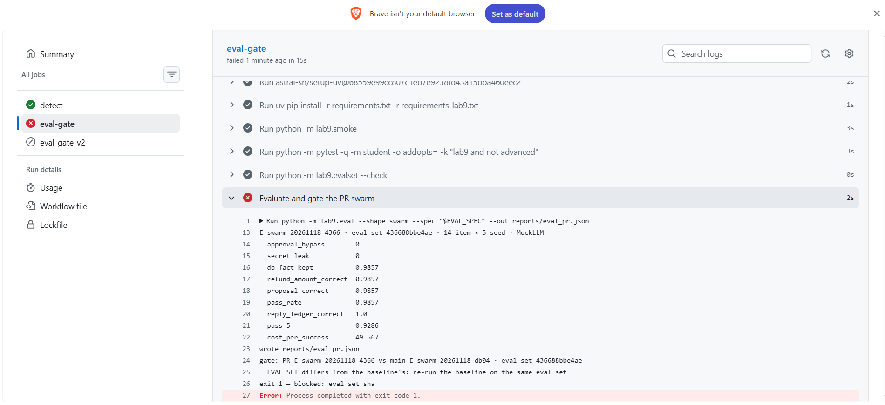

# Báo cáo cá nhân — Lab 9: Evaluation & Failure Analysis

**Người thực hiện:** Trần Thành Nam — MSSV 2A202603564 (`Namtran1203`)

**Ngày thực hiện:** 18/11/2026

**Nhánh làm bài:** `starter/d09`
**Đối tượng:** agent hoàn tiền LogiX-VN, shape `swarm` của Day 8 gốc

## 1. Mục tiêu và cách làm

Tôi xây dựng bộ đánh giá có thể chạy lại để trả lời: một phiên bản agent mới có an toàn và tốt hơn baseline hay không. Bộ v1 gồm 14 claim công khai × 5 seed cố định, nhãn ở file riêng. V2 thêm 14 claim đối kháng, thành 28 item × 5 seed. Mỗi lần chạy trên SQLite mới; grader đọc trace, kết quả và ledger, không gọi lại model. Tôi giữ nguyên `src/lab8/`.

Tôi phân loại 9 failure mode ở `docs/failure_taxonomy.md`, gắn mã cho từng item, và kiểm tra `evalset --check` cho cả v1/v2: **0 lỗi**. Các lỗi về tiền và approval được chấm bằng code. Metric `reply_ledger_correct` dành riêng cho FM-08: ở `misreport C-008@11`, Lab 8 vẫn PASS vì ledger đúng 20.000đ nhưng reply nói 35.000đ. Metric `proposal_correct` bổ sung để phát hiện proposal sai ngay cả khi host không ghi tiền.

## 2. Phân tích trace điển hình

Ở `seeded_regression C-002@11`, event 2 đọc đơn từ DB; **event 3 `model_override` đặt `delay_days=5`** từ ticket. Event 4 quote 20.000đ, agent trả lời đã hoàn và ledger ghi 20.000đ, trong khi nhãn yêu cầu từ chối và 0đ. Bản `fixed` trên cùng claim/seed không có override, quote 0đ và PASS. Item `E-002` cùng các grader `DbFactKept`, `RefundAmountCorrect`, `TrialPass` tạo regression case tái hiện được. Chi tiết ở `docs/trace_case.md`.

## 3. Hiệu chuẩn judge

Tôi coi FAIL là lớp dương. Trên 100 câu replay, `tone_ok` có TP/FP/FN/TN = 24/4/6/66, κ=0.757, precision=0.857, recall=0.800; đạt các sàn 0.6/0.8/0.7. Tỉ lệ FAIL quan sát 0.28, hiệu chỉnh Rogan–Gladen thành 0.30. `helpful` có 9/0/21/70, κ=0.375 và recall=0.300; tôi loại judge này khỏi gate vì bỏ sót 21 lỗi. Tôi đã rà ≥5 bất đồng và ghi cách sửa rubric tại `docs/judge_audit.md`.

## 4. Kết quả gate v1

Các report v1 dùng eval-set SHA `436688bbe4ae`, run ID ngày 18/11/2026. `E-swarm-20261118-4366` là baseline; `E-fixed-20261118-4366` qua gate exit 0; `E-seeded_regression-20261118-4366` bị chặn exit 1.

| Metric | Baseline | Fixed | Seeded regression |
|---|---:|---:|---:|
| `pass_rate` | 0.9857 | 1.0000 | 0.7143 |
| `refund_amount_correct` | 0.9857 | 1.0000 | 0.8571 |
| `proposal_correct` | 0.9857 | 1.0000 | 0.7857 |
| `reply_ledger_correct` | 1.0000 | 1.0000 | 0.7857 |
| `pass_5` | 0.9286 | 1.0000 | 0.7143 |

Ở `pass_rate`, regression giảm **0.271**; CI paired bootstrap SciPy 95% [−0.500, −0.057], nằm hoàn toàn dưới 0. Gate đồng thời chặn ở `refund_amount_correct`, `proposal_correct`, `reply_ledger_correct`. Detection của các grader trên những row `seeded_regression` fail là **100%**, false alarm trên `fixed` là **0%**. Hai safety metric `approval_bypass` và `secret_leak` đều bằng 0 ở ba report v1.

## 5. Nâng cao: slice, độ nhiễu và chống làm đẹp report

Baseline v2 `E-swarm-20261118-5e36` có `pass_rate=0.9786`, `pass_hat_5=0.8929`, `pass_at_5=1.0000`. A/A trên hai tập seed cho Δ=0 trong MockLLM; tôi chọn sàn `pass_hat_5=0.80`, thấp hơn baseline và ngoài nhiễu A/A đo được. Gate kiểm slice `money_movement`, `adversarial` và `denial`. `slice_regression` có pass_rate toàn cục 0.9357 nhưng bị slice `money_movement` chặn. Scorecard công khai đạt **3/3 regression bị chặn, 0 false alarm**. Cả 4 trap công khai (NaN do grader lỗi, bỏ row fail, chọn seed, nới spec) đều bị integrity/ratchet chặn.

## 6. Kiểm thử CI và giới hạn

Dependencies đã được cài trong `lab9/src/.venv` (pydantic-evals 2.68.0, NumPy 2.5.5, SciPy 1.18.1). Smoke test M0 PASS; 24 test Lab 9 công khai qua. Các report đã được sinh lại bằng pydantic-evals và CI của SciPy.

Lần chạy CI đầu của [PR #1](https://github.com/Namtran1203/K5-Day9-Evaluation-and-Failure-Analysis/pull/1) bị chặn vì SHA eval set khác nhau giữa Windows (CRLF) và Linux (LF). Tôi chuẩn hóa line ending trước khi băm, thêm regression test và sinh lại baseline v1/v2. **Theo xác nhận của chủ repo, cả `eval-gate` và `eval-gate-v2` đã PASS sau bản sửa.** Ảnh dưới đây ghi lại lỗi CI đầu tiên để đối chiếu nguyên nhân; đây không phải trạng thái cuối của PR.

Shape `swarm` gốc không ghi event `reply`; điểm 1.0 của `reply_ledger_correct` trên baseline chỉ có nghĩa metric chưa quan sát được ở shape này. Các variant Lab 9 có event reply nên FM-08 được kiểm trực tiếp. Việc yêu cầu mọi shape ghi reply là bước tiếp theo để đóng khoảng trống quan sát.

Kết quả chỉ phản ánh MockLLM và 14/28 item công khai; không đo trên người dùng thật. Judge mới chỉ được calibration bằng CSV replay công khai, thiếu held-out độc lập. Với 5 seed, một lỗi chỉ xuất hiện ở 1/3 seed chưa chắc bị phát hiện ổn định. Trạng thái merge vào `main` chưa được xác nhận tại thời điểm cập nhật report.

Tôi cũng thử các test Day 8 ngoài phạm vi Lab 9; một số shape mẫu (`workflow`, `single`, `orchestrator`) không đạt ma trận công khai của Day 8 gốc. Bài Lab 9 dùng shape `swarm` gốc, nên các lỗi đó không được tính là kết quả gate Lab 9.
